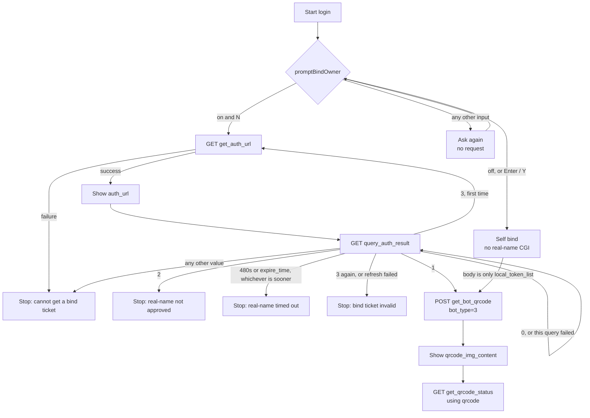
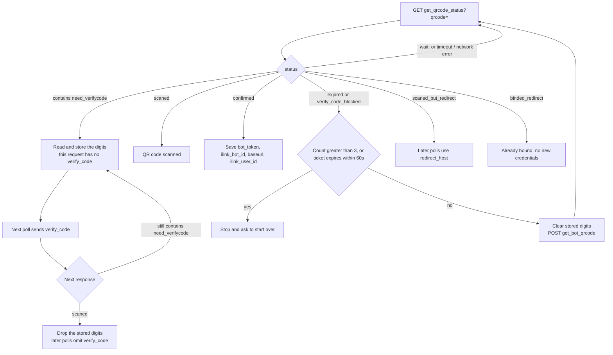

# Weixin Backend API Protocol

This document describes the HTTP JSON protocol used by the `openclaw-weixin` channel plugin. It is intended for developers implementing or integrating a compatible Weixin backend. Normal plugin users only need the [main README](../README.md).

[简体中文](./protocol_zh_CN.md)

## How to read this reference

This reference is based on the current repository's client code. It distinguishes three kinds of information:

- **Fields and examples** describe the wire format represented by the client types and request builders.
- **Client behavior** describes what this plugin currently sends, accepts, or retries.
- **Integration guidance** gives recommendations for other implementations.

Client types and behavior do not establish the complete server contract. In particular, a TypeScript optional field does not prove that the server accepts requests without it, and a field defined in a type does not imply that the plugin implements every associated feature.

Unless otherwise stated, JSON examples illustrate selected fields and are not verified minimal requests or exhaustive responses. Replace placeholders with actual values. `channel_version` is populated from package metadata; `2.4.8` is an example value.

Source references: [`src/api/api.ts`](../src/api/api.ts), [`src/api/types.ts`](../src/api/types.ts), [`src/auth/login-qr.ts`](../src/auth/login-qr.ts), and [`src/auth/bot-spam-ticket.ts`](../src/auth/bot-spam-ticket.ts). Server requirements beyond what these sources show need separate verification.

## Scope and transport

- API requests use JSON over HTTPS.
- API paths are relative to the current API base URL.
- Normal API methods use `POST`; QR-code status polling uses `GET`.
- JSON byte fields are represented as base64 strings.
- The default API base URL is `https://ilinkai.weixin.qq.com`.
- The default CDN base URL is `https://novac2c.cdn.weixin.qq.com/c2c`.

The QR-code flow starts at the fixed API base URL. After a successful redirect response, the client may poll QR status at the returned host. For CDN media, a server-provided full URL takes precedence over a URL constructed from the configured CDN base URL.

## Authentication and common metadata

### Request headers

The following headers are added by the plugin where applicable:

| Header | Value |
| --- | --- |
| `Content-Type` | `application/json` for JSON POST requests |
| `AuthorizationType` | `ilink_bot_token` |
| `Authorization` | `Bearer <bot_token>` for authenticated bot API requests |
| `X-WECHAT-UIN` | Base64-encoded decimal representation of a random uint32 |
| `iLink-App-Id` | The plugin application ID, currently `bot` |
| `iLink-App-ClientVersion` | Plugin version encoded as `0x00MMNNPP` and sent as a decimal string |
| `SKRouteTag` | Optional route tag configured by the deployment. Every Weixin API URL also receives `_cradle_hostname=g<routeTag>` |

Client behavior: QR-code status polling sends the application headers (`iLink-App-Id`, `iLink-App-ClientVersion`, and optional `SKRouteTag`). It does not add `AuthorizationType`, `Authorization`, or `X-WECHAT-UIN`. The QR-code POST request uses the JSON POST headers, including `AuthorizationType` and `X-WECHAT-UIN`, but omits `Authorization` and `base_info`.

### `base_info`

Authenticated bot POST requests include a `base_info` object:

```json
{
  "base_info": {
    "channel_version": "2.4.8",
    "bot_agent": "OpenClaw"
  }
}
```

`channel_version` is the plugin version. Its format is defined in the next section. `bot_agent` is an optional, sanitized observability identifier configured through `channels.openclaw-weixin.botAgent`; it is not used for authentication or routing.

Client behavior: `buildBaseInfo()` always supplies both fields. `bot_agent` defaults to `OpenClaw`. Custom values use ASCII `Name/Version` tokens with optional comments, with a maximum of 256 bytes after sanitization. Invalid tokens are dropped; an empty result falls back to `OpenClaw`. This declaration is shared across accounts in the plugin instance.

### Plugin version

`channel_version` and the real-name `plugin_version` carry the same plugin version string. The bot backend identifies the plugin from `base_info.channel_version`.

The value must start with three decimal integers, `major.minor.patch`. One leading `v` or `V` is allowed. Anything after the third number is a suffix and is not compared. The server stops after the third number, so `-rc.1`, `+build`, a space, or `/` is only a suffix.

| String | Recognized version |
| --- | --- |
| `3.0.1` | `3.0.1` |
| `v3.0.1`, `V3.0.1-rc.1` | `3.0.1` |
| `3.0.1/hermes-1.2.0` | `3.0.1` |
| `3.0.1 forge-weixin-bridge` | `3.0.1` |
| `3.0`, `3..1`, `hermes-1.2.0`, `1.2.0/hermes`, `unknown` | not recognized |

An empty string, a value that cannot be recognized, or a value above the configured maximum is stored as `0.0.0`. A value below the configured minimum keeps its three numbers and is treated as unsupported. The original string is stored separately and is preferred for display.

Another host that has its own version must put the openclaw-weixin version in the first three numbers and its own version in the suffix. This plugin generation is `3.x.x`. Hermes should send `3.0.1/hermes-xxxx`. `hermes-xxxx` or `1.2.0/hermes` is either unrecognized, or causes the server to treat the Hermes version as the plugin version.

### Return values and errors

The response types use fields such as `ret`, `errcode`, and `errmsg`; they are not present on every endpoint. `ret: 0` represents success where used.

Current client behavior differs by operation:

| Operation | Application response handling |
| --- | --- |
| `getUpdates` | The monitor checks non-zero `ret` or `errcode`. Either field equal to `-14` triggers a one-hour account session pause; other failures follow the monitor's retry/backoff policy. |
| `sendMessage` | A non-zero `ret` throws; an absent `ret` does not trigger this check. |
| `getUploadUrl` | The upload caller requires a nonempty `upload_full_url` or `upload_param`; it does not explicitly check `ret`. |
| `getConfig` | The cache layer accepts configuration only when `ret === 0`; failures use cached/default configuration and schedule another attempt. |
| `sendTyping` | The wrapper does not parse the response body or check its business return code. |
| `notifyStart` / `notifyStop` | Non-zero `ret` or request failures are logged as warnings by channel lifecycle handlers, without blocking startup/shutdown. |

The JSON fetch wrappers throw on non-successful HTTP status. `getUpdates` converts a timeout or external cancellation into an empty result; cancellation lets the monitor exit rather than continue polling. QR status polling converts request failures into `wait`.

Integration guidance: handle HTTP status separately from business return codes, define retry behavior per operation, and redact credentials in diagnostic output. These are recommendations, not a claim that the current client applies a single uniform error or redaction policy.

## QR-code login

Binding has two paths. Both end by polling the same bot-bind QR code. When the phone asks for digits, the PIN is added to that ilink poll. It is not sent to the real-name CGI.

`channels.openclaw-weixin.promptBindOwner` defaults to `false`.

| Condition | Client behavior |
| --- | --- |
| The option is off, or it is on and the operator presses Enter or types `Y` / `y` | Self bind. The client does not call the real-name CGI and omits `bot_spam_ticket` |
| The option is on and the operator types `n` / `N` | Other-owner bind. Complete real-name authorization, then send the ticket with the bind request |
| The option is on and the input is anything else | Ask again. No request is sent during that prompt |



### Self bind

1. `POST https://ilinkai.weixin.qq.com/ilink/bot/get_bot_qrcode?bot_type=3` with only `local_token_list`.
2. Display `qrcode_img_content` from the response.
3. Poll `get_qrcode_status` with `qrcode` from the response. If a status requires a PIN, follow "Poll bind status and the PIN".

### Other-owner bind

This path runs only when `promptBindOwner` is `true` and the operator chooses N.

1. `GET get_auth_url` and read `bot_spam_ticket`, `auth_url`, and `expire_time`. On failure, stop. Do not request a bind QR code.
2. Render `auth_url` as the real-name QR code for the operator's own WeChat. The scanning account must already have WeChat Pay real-name verification enabled.
3. Poll `query_auth_result` until `auth_status` is `1`. Status `2`, an unrecoverable `3`, or a timeout stops the flow. Do not request a bind QR code.
4. `POST get_bot_qrcode` with both `local_token_list` and that `bot_spam_ticket`.
5. Display the bind QR code and poll `get_qrcode_status`. A PIN can still be required here.

### Real-name bind

The WeChat account that scans the real-name QR code must already have WeChat Pay real-name verification enabled. An account without it cannot complete this authorization.

The real-name CGI is not the ilink host. The default origin is `https://weixin110.qq.com` and the path is fixed at `/security/acct/botrealnameverifycgi`. The method is `GET`. The only header is `Accept: application/json`. These requests do not carry a bot `Authorization` header or `base_info`. Each request times out after 10 seconds. A non-2xx HTTP status or a non-JSON body stops the connection.

`channels.openclaw-weixin.acctwebBaseUrl` replaces only the origin (scheme, host, and port). The CGI path stays the same. `channels.openclaw-weixin.acctwebProxy` proxies only `get_auth_url` and `query_auth_result`. A configured `routeTag` adds `_cradle_hostname=g<routeTag>`; a value that already starts with `g` is kept as-is. The same fields under `accounts.<accountId>` override the channel values.

Business fields may be at the top level or inside a `data` object. The client reads both. A numeric top-level `ret` or `errcode` other than `0` is a failure. `expire_time` and `auth_status` may be a number or a decimal digit string.

#### Fetch a ticket

```http
GET /security/acct/botrealnameverifycgi?step=get_auth_url&plugin_version=<plugin version>
```

`plugin_version` uses the same version string as `base_info.channel_version`. See "Plugin version". Examples are `3.0.1` and `3.0.1/hermes-1.2.0`.

Success response:

```json
{
  "ret": 0,
  "bot_spam_ticket": "0123456789abcdef0123456789abcdef",
  "auth_url": "liteapp://wxalite.../pages/realname-verify/entry?bot_spam_ticket=0123456789abcdef0123456789abcdef",
  "expire_time": 1800000000
}
```

The same fields may be nested:

```json
{
  "ret": 0,
  "data": {
    "bot_spam_ticket": "0123456789abcdef0123456789abcdef",
    "auth_url": "liteapp://wxalite.../pages/realname-verify/entry?bot_spam_ticket=0123456789abcdef0123456789abcdef",
    "expire_time": "1800000000"
  }
}
```

| Field | Client requirement |
| --- | --- |
| `bot_spam_ticket` | 32 hexadecimal characters, either case |
| `auth_url` | Non-empty string. The client renders it as the real-name QR code |
| `expire_time` | Unix seconds, and it must be later than the current time |

If any field fails that check, or `ret` / `errcode` is non-zero, the client stops. The operator sees "无法获取绑定凭证，连接已停止。" The client does not call `get_bot_qrcode` after that.

#### Query the authorization result

After showing the real-name QR code, the client polls:

```http
GET /security/acct/botrealnameverifycgi?step=query_auth_result&bot_spam_ticket=0123456789abcdef0123456789abcdef
```

Success response:

```json
{
  "ret": 0,
  "auth_status": 1
}
```

`auth_status` may instead be `data.auth_status`.

| `auth_status` | Client behavior |
| --- | --- |
| `0` | Still pending. Query again after about 1 second |
| `1` | Authorized. Request the bind QR code with the current ticket |
| `2` | Authorization failed. Stop without requesting a bind QR code. The message is "实名授权未通过，无法连接。" |
| `3` | The ticket is invalid. Call `get_auth_url` once more, show the new `auth_url`, and continue. A second `3`, or a failed refresh, stops with "绑定凭证无效，请重新开始连接。" |
| any other value | Stop, using the same failure path as a bad `get_auth_url` response |

If this query itself fails (HTTP error, non-JSON body, or non-zero `ret`), the client treats that round as `0` and keeps waiting.

The wait ends at the earlier of 480 seconds and `expire_time`. A timeout says "实名授权超时，请重新开始连接。"

### Get the bind QR code

An other-owner bind sends this request only after `auth_status` is `1`. A self bind sends it immediately. The host is fixed at `https://ilinkai.weixin.qq.com`.

```http
POST /ilink/bot/get_bot_qrcode?bot_type=3
```

Other-owner request body:

```json
{
  "local_token_list": [],
  "bot_spam_ticket": "0123456789abcdef0123456789abcdef"
}
```

Self-bind request body, without `bot_spam_ticket`:

```json
{
  "local_token_list": []
}
```

`local_token_list` holds at most the ten most recent local bot tokens and may be an empty array. When `bot_spam_ticket` is present, it must be 32 hexadecimal characters.

Response body:

```json
{
  "qrcode": "<qrcode value>",
  "qrcode_img_content": "<url or content to display as a QR code>"
}
```

The client displays `qrcode_img_content`. Later status polls use `qrcode`, not `qrcode_img_content`.

### Poll bind status and the PIN

```http
GET /ilink/bot/get_qrcode_status?qrcode=<encoded qrcode>
```

This is a long poll. The client waits 35 seconds per request. A timeout, cancellation, or network error is treated as `status` `wait`, and polling continues.

The PIN exists only on this poll. The real-name CGI does not accept `verify_code`. Both self bind and other-owner bind can reach this step.



1. Before any digits are entered, the query string contains only `qrcode`.
2. When `status` contains `need_verifycode` (including `need_verifycode` and `confirmed_but_need_verifycode`), the client reads the digits and stores them. The request that returned this status did not include `verify_code`.
3. The next poll adds `verify_code`:

```http
GET /ilink/bot/get_qrcode_status?qrcode=<encoded qrcode>&verify_code=<encoded digits>
```

4. If the next response still contains `need_verifycode`, the previous digits did not match. The client reads a new value and sends it on the following poll.
5. `scaned` means the digits were accepted. The client drops the stored digits, and later polls omit `verify_code`.
6. `verify_code_blocked` means too many failures. The client clears the stored digits and `POST`s `get_bot_qrcode` again for a new bind QR code. An other-owner bind still sends the original `bot_spam_ticket`. If that ticket expires within 60 seconds, the client does not refresh the QR code and asks the operator to start over.
7. `expired` refreshes the bind QR code with the same rule.

The refresh counter starts at 1 and increases by 1 on each expiry or block. When it becomes greater than 3, the client stops and asks the operator to retry later.

Response body:

```json
{
  "status": "confirmed",
  "bot_token": "<bot token>",
  "ilink_bot_id": "<bot account id>",
  "baseurl": "https://<api host>",
  "ilink_user_id": "<scanning user id>",
  "redirect_host": "<present for scaned_but_redirect>"
}
```

| Status | Meaning |
| --- | --- |
| `wait` | Waiting for a scan or another state change. A failed request is also treated as this status |
| `scaned` | The QR code was scanned. If this request included `verify_code`, the digits were accepted |
| `confirmed` | Login succeeded. Store `bot_token`, `ilink_bot_id`, `baseurl`, and `ilink_user_id` |
| `expired` | The bind QR code expired. Fetch a new one with the rule above |
| any status containing `need_verifycode` | Read the digits shown on the phone and send them as `verify_code` on the next poll |
| `verify_code_blocked` | Too many wrong digits. Clear the stored digits and refresh the bind QR code, or stop after the refresh limit |
| `scaned_but_redirect` | When `redirect_host` is present, later polls use `https://<redirect_host>` |
| `binded_redirect` | This bot is already bound to the current OpenClaw instance, so no new credentials are issued |

## Bot API

### Endpoint overview

| Operation | Method and path | Purpose |
| --- | --- | --- |
| `getUpdates` | `POST /ilink/bot/getupdates` | Long-poll for inbound messages |
| `getUploadUrl` | `POST /ilink/bot/getuploadurl` | Get media upload parameters |
| `sendMessage` | `POST /ilink/bot/sendmessage` | Send a message |
| `getConfig` | `POST /ilink/bot/getconfig` | Get account configuration and typing ticket |
| `sendTyping` | `POST /ilink/bot/sendtyping` | Set or cancel typing status |
| `notifyStart` | `POST /ilink/bot/msg/notifystart` | Notify the backend that the client started |
| `notifyStop` | `POST /ilink/bot/msg/notifystop` | Notify the backend that the client stopped |

All requests in this section include the common headers, bot authorization, and `base_info` unless stated otherwise.

### `getUpdates`

```http
POST /ilink/bot/getupdates
```

Request:

```json
{
  "get_updates_buf": "",
  "base_info": {
    "channel_version": "2.4.8",
    "bot_agent": "OpenClaw"
  }
}
```

The client sends the previous response's `get_updates_buf`. It sends an empty string for the first request or after a reset. The server should hold the request until a message is available or the long-poll timeout is reached.

Response:

```json
{
  "ret": 0,
  "msgs": [],
  "get_updates_buf": "<next cursor>",
  "longpolling_timeout_ms": 35000
}
```

| Field | Type | Description |
| --- | --- | --- |
| `ret` | `number` | `0` means success |
| `errcode` | `number` | Optional application error code |
| `errmsg` | `string` | Optional error description |
| `msgs` | `WeixinMessage[]` | Inbound messages |
| `get_updates_buf` | `string` | Cursor to send in the next request |
| `longpolling_timeout_ms` | `number` | Optional server-suggested timeout in milliseconds |

`sync_buf` remains deprecated in the TypeScript types. The current request builder sends only `get_updates_buf`, and the monitor does not use `sync_buf` as a response fallback. It saves a returned cursor only when `get_updates_buf` is nonempty.

### `sendMessage`

```http
POST /ilink/bot/sendmessage
```

Example matching the current text-message builder when a context token is available (`run_id` is additionally included when supplied):

```json
{
  "msg": {
    "from_user_id": "",
    "to_user_id": "<target user id>",
    "client_id": "<client-generated id>",
    "message_type": 2,
    "message_state": 2,
    "context_token": "<conversation context token>",
    "item_list": [
      {
        "type": 1,
        "text_item": { "text": "Hello" }
      }
    ]
  },
  "base_info": {
    "channel_version": "2.4.8",
    "bot_agent": "OpenClaw"
  }
}
```

Response:

```json
{
  "ret": 0,
  "errmsg": ""
}
```

Integration guidance: pass back the inbound `context_token` when replying to that conversation. Client behavior: the send helper logs a warning and still sends if the token is missing; this does not establish whether the server will accept that request. Media captions and media items are currently sent in separate requests, each with its own `client_id`.

### `getUploadUrl`

```http
POST /ilink/bot/getuploadurl
```

Request:

```json
{
  "filekey": "<client-generated file key>",
  "media_type": 1,
  "to_user_id": "<target user id>",
  "rawsize": 12345,
  "rawfilemd5": "<plaintext md5>",
  "filesize": 12352,
  "no_need_thumb": true,
  "aeskey": "<16-byte key as hex>",
  "base_info": {
    "channel_version": "2.4.8",
    "bot_agent": "OpenClaw"
  }
}
```

| Field | Type | Description |
| --- | --- | --- |
| `media_type` | `number` | `1` image, `2` video, `3` file, `4` voice |
| `rawsize` | `number` | Plaintext size in bytes |
| `rawfilemd5` | `string` | Plaintext MD5 |
| `filesize` | `number` | Ciphertext size after AES-128-ECB with PKCS#7 padding |
| `thumb_rawsize` | `number` | Thumbnail plaintext size when needed |
| `thumb_rawfilemd5` | `string` | Thumbnail plaintext MD5 when needed |
| `thumb_filesize` | `number` | Thumbnail ciphertext size when needed |
| `no_need_thumb` | `boolean` | Set when no thumbnail upload is needed |
| `aeskey` | `string` | AES key as a hexadecimal string |

Response:

```json
{
  "upload_param": "<encrypted upload parameter>",
  "thumb_upload_param": "<encrypted thumbnail parameter>",
  "upload_full_url": "<optional complete upload URL>"
}
```

The client prefers `upload_full_url`. If it is absent, it constructs a CDN upload URL from `upload_param` and `filekey`.

The types expose thumbnail request fields and `thumb_upload_param`. Current client behavior: the shared upload pipeline always sends `no_need_thumb: true`, uploads only the original file, and does not consume `thumb_upload_param`. These fields do not indicate implemented thumbnail upload support. Likewise, `media_type: 4` is defined in the types, while the current file-send pipeline selects image, video, or file upload.

### `getConfig`

```http
POST /ilink/bot/getconfig
```

Request:

```json
{
  "ilink_user_id": "<user id>",
  "context_token": "<optional conversation context token>",
  "base_info": {
    "channel_version": "2.4.8",
    "bot_agent": "OpenClaw"
  }
}
```

Response:

```json
{
  "ret": 0,
  "typing_ticket": "<base64 typing ticket>"
}
```

### `sendTyping`

```http
POST /ilink/bot/sendtyping
```

Request:

```json
{
  "ilink_user_id": "<user id>",
  "typing_ticket": "<ticket from getConfig>",
  "status": 1,
  "base_info": {
    "channel_version": "2.4.8",
    "bot_agent": "OpenClaw"
  }
}
```

`status` is `1` for typing and `2` for cancel typing.

### `notifyStart` and `notifyStop`

```http
POST /ilink/bot/msg/notifystart
POST /ilink/bot/msg/notifystop
```

Request:

```json
{
  "base_info": {
    "channel_version": "2.4.8",
    "bot_agent": "OpenClaw"
  }
}
```

Response:

```json
{
  "ret": 0,
  "errmsg": ""
}
```

The plugin sends `notifyStart` when a channel client starts and `notifyStop` when it stops.

## Message model

These tables summarize client-side types. `WeixinMessage`, `MessageItem`, and media-object properties are optional in the TypeScript definitions; the tables do not declare server-required fields. Fields such as `group_id` describe the type surface, not a guarantee of plugin feature support.

### `WeixinMessage`

| Field | Type | Description |
| --- | --- | --- |
| `seq` | `number` | Message sequence number |
| `message_id` | `number` | Message ID |
| `from_user_id` | `string` | Sender ID |
| `to_user_id` | `string` | Receiver ID |
| `client_id` | `string` | Client-generated or client-associated ID |
| `create_time_ms` | `number` | Creation timestamp in milliseconds |
| `update_time_ms` | `number` | Update timestamp in milliseconds |
| `delete_time_ms` | `number` | Deletion timestamp in milliseconds |
| `session_id` | `string` | Session ID |
| `group_id` | `string` | Group ID when applicable |
| `message_type` | `number` | `1` user, `2` bot |
| `message_state` | `number` | `0` new, `1` generating, `2` finished |
| `item_list` | `MessageItem[]` | Message content items |
| `context_token` | `string` | Conversation context for replies |
| `run_id` | `string` | Generation or run ID when applicable |

### `MessageItem`

| `type` | Content |
| ---: | --- |
| `1` | `text_item` |
| `2` | `image_item` |
| `3` | `voice_item` |
| `4` | `file_item` |
| `5` | `video_item` |
| `11` | `tool_call_start_item` |
| `12` | `tool_call_result_item` |

Common item fields include `create_time_ms`, `update_time_ms`, `is_completed`, `msg_id`, and an optional `ref_msg` containing a referenced message item.

`voice_item` may include a transcript in `text`. Media items can include a `media` object, and images and videos can additionally include `thumb_media`.

### Media fields used by the client

| Field | Type | Current use |
| --- | --- | --- |
| `image_item.aeskey` | `string` | Inbound AES key as 32 hex characters; takes precedence over `media.aes_key`. |
| `image_item.mid_size` | `number` | Ciphertext byte count set by the image sender. |
| `video_item.video_size` | `number` | Ciphertext byte count set by the video sender. |
| `file_item.file_name` | `string` | Attachment filename. |
| `file_item.len` | `string` | Plaintext byte count encoded as a decimal string by the file sender. |
| `voice_item.text` | `string` | Transcript when present. |
| `voice_item.encode_type` | `number` | Codec identifier in the types; does not imply decoding support for every codec. |
| `voice_item.sample_rate` / `playtime` | `number` | Sample rate in Hz / duration in milliseconds. |

See [protocol types](../src/api/types.ts) for the remaining fields and [message builders](../src/messaging/send.ts) for outgoing payloads.

### CDN media reference

```json
{
  "encrypt_query_param": "<download parameter>",
  "aes_key": "<base64 encoded AES key>",
  "encrypt_type": 1,
  "full_url": "<optional complete download URL>"
}
```

The client prefers `full_url`. When a full URL is unavailable, a compatible deployment can construct a download URL as:

```text
<cdn_base_url>/download?encrypted_query_param=<url-encoded encrypt_query_param>
```

The download decoder accepts base64 of either 16 raw bytes or a 32-character hexadecimal key. Current image, video, and file senders all encode the hexadecimal key string as base64. These describe accepted encodings and outgoing behavior, respectively; they are not a mandatory encoding split by media type.

## CDN media flow

### Upload

1. Read the plaintext file and calculate its size and MD5.
2. Generate a 16-byte AES key and a file key.
3. Calculate the padded ciphertext size.
4. Call `getUploadUrl`.
5. Encrypt the content with AES-128-ECB and PKCS#7 padding.
6. Send the encrypted bytes to the returned upload URL with `Content-Type: application/octet-stream`.
7. Read the `x-encrypted-param` response header.
8. Put the returned download parameter and AES key into the media reference sent through `sendMessage`.

Current client behavior: uploads use HTTP `POST`. Only original files are uploaded, with `no_need_thumb: true`; there is no thumbnail upload step.

Success requires HTTP `200` and a nonempty `x-encrypted-param` response header. HTTP 4xx errors abort immediately. Other failures, including a missing response header, are attempted up to three times total. This is the plugin's current acceptance and retry policy.

### Download

1. Prefer `full_url`. The current client enables URL fallback and constructs a CDN download URL from `encrypt_query_param` when a full URL is absent.
2. Download the bytes with HTTP `GET`.
3. For images, prefer the hex key in `image_item.aeskey`, then `image_item.media.aes_key`. If neither is available, use the downloaded image bytes as plaintext.
4. For encrypted images, voice, files, and videos, decode the key and decrypt with AES-128-ECB and PKCS#7 padding. Voice, file, and video items without `media.aes_key` are skipped by the current media downloader.

## Source references

- [API request implementation](../src/api/api.ts)
- [Protocol types](../src/api/types.ts)
- [QR-code login flow](../src/auth/login-qr.ts)
- [Real-name authorization CGI](../src/auth/bot-spam-ticket.ts)
- [CDN upload implementation](../src/cdn/upload.ts)
- [CDN encryption utilities](../src/cdn/aes-ecb.ts)
- [Message builders](../src/messaging/send.ts)
- [Inbound media handling](../src/media/media-download.ts)
- [CDN upload transport](../src/cdn/cdn-upload.ts)
- [Message polling and retries](../src/monitor/monitor.ts)
- [Configuration cache](../src/api/config-cache.ts)
- [Channel lifecycle](../src/channel.ts)
