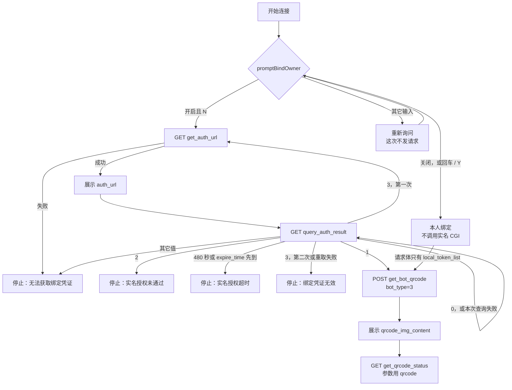
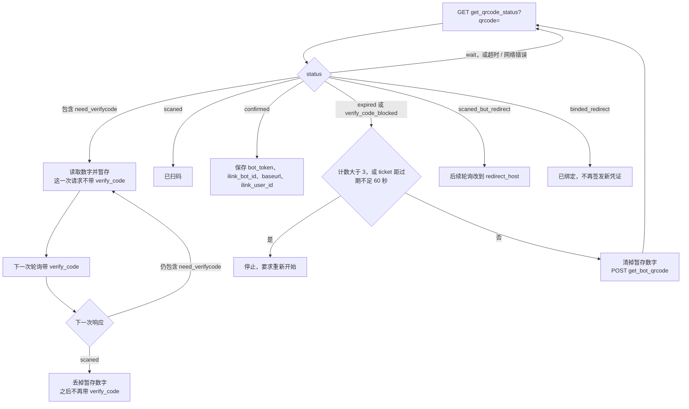

# 微信后端 API 协议

本文描述 `openclaw-weixin` 渠道插件使用的 HTTP JSON 协议，面向实现或对接兼容微信后端的开发者。普通用户只需阅读[项目 README](../README.zh_CN.md)。

[English](./protocol.md)

## 阅读约定

本文依据当前仓库的客户端代码编写，区分以下三类信息：

- **字段与示例**：说明客户端类型和请求构造代码体现的数据格式。
- **客户端行为**：说明当前插件实际发送、接受或重试的内容。
- **接入建议**：为其他实现提供参考建议。

客户端类型和行为不能代表完整的服务端契约。尤其是，TypeScript 字段标记为可选，不代表服务端一定接受省略该字段的请求；类型中定义了某个字段，也不代表插件已经实现所有相关能力。

除非另有说明，JSON 示例用于展示部分字段，不代表经过验证的最小可用请求或完整响应。使用时需要替换占位符。`channel_version` 来自包元数据，示例中的 `2.4.8` 仅为示例值。

源码依据：[`src/api/api.ts`](../src/api/api.ts)、[`src/api/types.ts`](../src/api/types.ts)、[`src/auth/login-qr.ts`](../src/auth/login-qr.ts) 和 [`src/auth/bot-spam-ticket.ts`](../src/auth/bot-spam-ticket.ts)。超出这些源码所体现范围的服务端要求，需要另行验证。

## 协议范围和传输方式

- API 使用 HTTPS 传输 JSON。
- API 路径相对于当前 API base URL。
- 普通 API 使用 `POST`；二维码状态轮询使用 `GET`。
- JSON 中的 bytes 字段使用 base64 字符串表示。
- 默认 API 地址为 `https://ilinkai.weixin.qq.com`。
- 默认 CDN 地址为 `https://novac2c.cdn.weixin.qq.com/c2c`。

二维码登录从固定 API 地址开始。服务端返回重定向信息后，客户端可能切换到返回的地址继续轮询二维码状态。媒体 CDN 如果由服务端直接返回完整 URL，客户端优先使用该 URL；否则再根据配置的 CDN 地址构造 URL。

## 鉴权和公共元数据

### 请求头

插件会在适用的请求中添加以下请求头：

| Header | 值 |
| --- | --- |
| `Content-Type` | JSON POST 请求使用 `application/json` |
| `AuthorizationType` | `ilink_bot_token` |
| `Authorization` | 鉴权 Bot API 使用 `Bearer <bot_token>` |
| `X-WECHAT-UIN` | 随机 uint32 的十进制字符串再进行 base64 编码 |
| `iLink-App-Id` | 插件应用 ID，目前为 `bot` |
| `iLink-App-ClientVersion` | 插件版本按 `0x00MMNNPP` 编码后转成十进制字符串 |
| `SKRouteTag` | 可选，由部署配置的路由标签。同时，所有微信接口 URL 会带上 `_cradle_hostname=g<routeTag>` |

客户端行为：二维码状态轮询发送应用请求头（`iLink-App-Id`、`iLink-App-ClientVersion` 和可选的 `SKRouteTag`），不添加 `AuthorizationType`、`Authorization` 或 `X-WECHAT-UIN`。获取二维码的 POST 请求使用 JSON POST 请求头，包括 `AuthorizationType` 和 `X-WECHAT-UIN`，但不携带 `Authorization` 和 `base_info`。

### `base_info`

鉴权 Bot POST 请求会携带 `base_info`：

```json
{
  "base_info": {
    "channel_version": "2.4.8",
    "bot_agent": "OpenClaw"
  }
}
```

`channel_version` 是插件版本，格式见下一节。`bot_agent` 是通过 `channels.openclaw-weixin.botAgent` 配置、经过清洗的观测标识，仅用于日志和监控归因，不参与鉴权或路由。

客户端行为：`buildBaseInfo()` 总是填充这两个字段。`bot_agent` 默认为 `OpenClaw`。自定义值采用 ASCII `Name/Version` token，可附带注释，清洗后最多 256 字节。不合法的 token 会被丢弃，结果为空时回退到 `OpenClaw`。插件实例中的各账号共享该声明。

### 插件版本号

`channel_version` 和实名接口的 `plugin_version` 使用同一份插件版本字符串。Bot 后台识别的是 `base_info.channel_version`。

版本必须以三段十进制整数开头，写成 `主版本.次版本.修订号`。开头可以多一个 `v` 或 `V`。第三段数字结束之后可以接任意后缀，后缀不参与版本比较。服务端读完第三段就停止，后面的 `-rc.1`、`+build`、空格或 `/` 都只是后缀。

| 字符串 | 识别出的版本 |
| --- | --- |
| `3.0.1` | `3.0.1` |
| `v3.0.1`、`V3.0.1-rc.1` | `3.0.1` |
| `3.0.1/hermes-1.2.0` | `3.0.1` |
| `3.0.1 forge-weixin-bridge` | `3.0.1` |
| `3.0`、`3..1`、`hermes-1.2.0`、`1.2.0/hermes`、`unknown` | 无法识别 |

无法识别、空字符串，或高于配置的最大支持版本时，后台把解析结果记成 `0.0.0`。低于最小支持版本会保留原来的三段数字，但按不支持的版本处理。上报原文会另外保存，展示时优先用原文。

其他宿主有自己的版本号时，前三段必须是 openclaw-weixin 的版本，自己的版本放在后缀里。这一代插件是 `3.x.x`。Hermes 应写成 `3.0.1/hermes-xxxx`。写成 `hermes-xxxx` 或 `1.2.0/hermes` 时，后台会识别失败，或把 Hermes 自己的版本当成插件版本。

### 返回值和错误

响应类型中包含 `ret`、`errcode`、`errmsg` 等字段，但并非每个接口都包含这些字段。使用 `ret` 的响应以 `ret: 0` 表示成功。

当前客户端按接口分别处理：

| 接口 | 业务响应处理 |
| --- | --- |
| `getUpdates` | monitor 检查非零 `ret` 或 `errcode`。任一字段为 `-14` 时触发一小时的账号会话暂停；其他失败按照 monitor 的重试和退避逻辑处理。 |
| `sendMessage` | 非零 `ret` 抛出错误；缺少 `ret` 不触发该检查。 |
| `getUploadUrl` | 上传调用方要求非空的 `upload_full_url` 或 `upload_param`，不显式检查 `ret`。 |
| `getConfig` | 缓存层只在 `ret === 0` 时接受配置；失败时使用缓存或默认配置，并安排再次尝试。 |
| `sendTyping` | 包装函数不解析响应体，也不检查其中的业务返回码。 |
| `notifyStart` / `notifyStop` | 渠道生命周期处理函数对非零 `ret` 或请求失败记录警告，不阻断启动或停止。 |

JSON fetch 包装函数会在 HTTP 状态不成功时抛出错误。`getUpdates` 将超时或外部取消转换为空结果；外部取消用于让 monitor 退出，而非继续轮询。二维码状态轮询将请求失败转换为 `wait`。

接入建议：分别处理 HTTP 状态和业务返回码，按接口定义重试策略，并对诊断输出中的凭证做脱敏。这些是建议，不表示当前客户端具有统一的错误处理或脱敏策略。

## 二维码登录

绑定有两条路径，最后都轮询同一张 bot 绑定二维码。手机要求输入数字时，PIN 加在这次 ilink 轮询上，不发给实名 CGI。

`channels.openclaw-weixin.promptBindOwner` 默认 `false`。

| 条件 | 客户端行为 |
| --- | --- |
| 配置关闭，或开启后操作者直接回车、输入 `Y` / `y` | 本人绑定。不调用实名 CGI，绑定请求不带 `bot_spam_ticket` |
| 配置开启，且操作者输入 `n` / `N` | 他人绑定。先完成实名授权，再把 ticket 放进绑定请求 |
| 配置开启，且输入不是上面几种 | 重新询问。这次询问期间不发请求 |



### 本人绑定

1. `POST https://ilinkai.weixin.qq.com/ilink/bot/get_bot_qrcode?bot_type=3`，请求体只有 `local_token_list`。
2. 展示响应里的 `qrcode_img_content`。
3. 用响应里的 `qrcode` 轮询 `get_qrcode_status`。若状态要求 PIN，按「轮询绑定状态与 PIN」处理。

### 他人绑定

只在 `promptBindOwner` 为 `true` 且操作者选择 N 时进入。

1. `GET get_auth_url`，拿到 `bot_spam_ticket`、`auth_url` 和 `expire_time`。失败则停止，不再要绑定码。
2. 把 `auth_url` 画成实名二维码，交给操作者本人用手机微信扫描。扫码账号必须已开通微信支付实名。
3. 轮询 `query_auth_result`，直到 `auth_status` 为 `1`。`2`、无法恢复的 `3` 或超时都停止，不再要绑定码。
4. `POST get_bot_qrcode`，请求体同时带 `local_token_list` 和这张 `bot_spam_ticket`。
5. 展示绑定二维码，再轮询 `get_qrcode_status`。PIN 仍可能出现在这一步。

### 实名绑定

扫描实名二维码的微信账号必须已经开通微信支付实名。没有开通的账号无法完成这次授权。

实名 CGI 与 ilink 不是同一主机。默认源是 `https://weixin110.qq.com`，路径固定为 `/security/acct/botrealnameverifycgi`。请求方法是 `GET`，请求头只有 `Accept: application/json`，不带 Bot `Authorization`，也不带 `base_info`。单次超时 10 秒。HTTP 非 2xx，或响应体不是 JSON，都停止连接。

`channels.openclaw-weixin.acctwebBaseUrl` 只替换源（scheme、host、port），路径不变。`channels.openclaw-weixin.acctwebProxy` 只代理 `get_auth_url` 和 `query_auth_result`。配置了 `routeTag` 时，查询串增加 `_cradle_hostname=g<routeTag>`；值本身已经以 `g` 开头则原样使用。账号级 `accounts.<accountId>` 里的同名字段优先于渠道级配置。

业务字段可以在 JSON 顶层，也可以包在 `data` 对象里，客户端两边都读。顶层 `ret` 或 `errcode` 为非 0 数字时视为失败。`expire_time` 和 `auth_status` 可以是数字，也可以是十进制数字字符串。

#### 获取 ticket

```http
GET /security/acct/botrealnameverifycgi?step=get_auth_url&plugin_version=<插件版本>
```

`plugin_version` 与 `base_info.channel_version` 使用同一版本字符串，格式见「插件版本号」。例如 `3.0.1`，或 `3.0.1/hermes-1.2.0`。

成功响应：

```json
{
  "ret": 0,
  "bot_spam_ticket": "0123456789abcdef0123456789abcdef",
  "auth_url": "liteapp://wxalite.../pages/realname-verify/entry?bot_spam_ticket=0123456789abcdef0123456789abcdef",
  "expire_time": 1800000000
}
```

字段也可以包在 `data` 里：

```json
{
  "ret": 0,
  "data": {
    "bot_spam_ticket": "0123456789abcdef0123456789abcdef",
    "auth_url": "liteapp://wxalite.../pages/realname-verify/entry?bot_spam_ticket=0123456789abcdef0123456789abcdef",
    "expire_time": "1800000000"
  }
}
```

| 字段 | 客户端要求 |
| --- | --- |
| `bot_spam_ticket` | 32 位十六进制，大小写均可 |
| `auth_url` | 非空字符串。客户端把它画成实名二维码 |
| `expire_time` | Unix 秒，必须大于当前时间 |

任一字段不满足，或 `ret` / `errcode` 非 0，客户端停止。操作者看到「无法获取绑定凭证，连接已停止。」之后不再调用 `get_bot_qrcode`。

#### 查询授权结果

展示实名码之后轮询：

```http
GET /security/acct/botrealnameverifycgi?step=query_auth_result&bot_spam_ticket=0123456789abcdef0123456789abcdef
```

成功响应：

```json
{
  "ret": 0,
  "auth_status": 1
}
```

`auth_status` 同样可以出现在 `data.auth_status`。

| `auth_status` | 客户端行为 |
| --- | --- |
| `0` | 尚未完成。约 1 秒后再次查询 |
| `1` | 授权通过。用当前 ticket 请求绑定二维码 |
| `2` | 授权未通过。停止，不再请求绑定二维码。提示「实名授权未通过，无法连接。」 |
| `3` | ticket 无效。重新调用一次 `get_auth_url`，换新的 `auth_url` 再展示。第二次仍是 `3`，或重取失败，停止并提示「绑定凭证无效，请重新开始连接。」 |
| 其它值 | 停止，处理方式与获取 ticket 失败相同 |

这一次查询本身失败（HTTP 错误、非 JSON、非 0 的 `ret`）时，客户端把这一轮当作 `0` 继续等，不立刻停止。

等待上限取 480 秒和 `expire_time` 中较早的时刻。超时提示「实名授权超时，请重新开始连接。」

### 获取绑定二维码

他人绑定只在 `auth_status` 为 `1` 之后发送。本人绑定直接发送。主机固定为 `https://ilinkai.weixin.qq.com`。

```http
POST /ilink/bot/get_bot_qrcode?bot_type=3
```

他人绑定的请求体：

```json
{
  "local_token_list": [],
  "bot_spam_ticket": "0123456789abcdef0123456789abcdef"
}
```

本人绑定的请求体没有 `bot_spam_ticket`：

```json
{
  "local_token_list": []
}
```

`local_token_list` 是本地最近最多 10 个 bot token，可以为空数组。出现 `bot_spam_ticket` 时，它必须是 32 位十六进制。

响应体：

```json
{
  "qrcode": "<二维码值>",
  "qrcode_img_content": "<用于展示二维码的 URL 或内容>"
}
```

客户端展示 `qrcode_img_content`。后续状态轮询使用 `qrcode`，不使用 `qrcode_img_content`。

### 轮询绑定状态与 PIN

```http
GET /ilink/bot/get_qrcode_status?qrcode=<编码后的二维码值>
```

这是长轮询，客户端单次等待 35 秒。超时、取消或网络错误都当成 `status` 为 `wait`，然后继续查。

PIN 只出现在这条轮询上。实名 CGI 不接收 `verify_code`。本人绑定和他人绑定都会走到这里。



1. 还没有数字时，查询串只有 `qrcode`。
2. 响应的 `status` 包含 `need_verifycode`（包括 `need_verifycode` 和 `confirmed_but_need_verifycode`）时，客户端读取操作者输入的数字并暂存。返回这个状态的那一次请求本身不带 `verify_code`。
3. 下一次轮询追加 `verify_code`：

```http
GET /ilink/bot/get_qrcode_status?qrcode=<编码后的二维码值>&verify_code=<编码后的数字>
```

4. 下一次响应仍包含 `need_verifycode` 时，上一次数字不匹配。客户端重新读取数字，再随再下一次轮询提交。
5. 响应 `scaned` 表示数字已被接受。客户端丢掉暂存数字，之后的轮询不再带 `verify_code`。
6. `verify_code_blocked` 表示失败次数过多。客户端清掉暂存数字，并重新 `POST get_bot_qrcode` 换一张绑定码。他人绑定仍提交原来的 `bot_spam_ticket`。这张 ticket 距离 `expire_time` 不足 60 秒时，不再换码，要求重新开始连接。
7. `expired` 同样重新 `POST get_bot_qrcode`，规则与上一步相同。

刷新计数从 1 开始，每次过期或锁定加 1。计数大于 3 时停止，提示稍后再试。

响应体：

```json
{
  "status": "confirmed",
  "bot_token": "<Bot token>",
  "ilink_bot_id": "<Bot 账号 ID>",
  "baseurl": "https://<API 地址>",
  "ilink_user_id": "<扫码用户 ID>",
  "redirect_host": "<仅 scaned_but_redirect 时出现>"
}
```

| 状态 | 含义 |
| --- | --- |
| `wait` | 等待扫码或状态变化。请求失败也按这个状态继续轮询 |
| `scaned` | 已扫码。若这次请求带了 `verify_code`，表示数字已被接受 |
| `confirmed` | 登录成功，保存 `bot_token`、`ilink_bot_id`、`baseurl` 和 `ilink_user_id` |
| `expired` | 绑定二维码过期。按上面的规则重新获取绑定码 |
| 任何包含 `need_verifycode` 的状态 | 读取手机上的数字，放到下一次轮询的 `verify_code` |
| `verify_code_blocked` | 数字错误次数过多。清掉暂存数字并刷新绑定码，超过上限后停止 |
| `scaned_but_redirect` | 响应带 `redirect_host` 时，后续轮询改到 `https://<redirect_host>` |
| `binded_redirect` | 这个 Bot 已经绑定到当前 OpenClaw，不再签发新凭证 |

## Bot API

### 接口总览

| 操作 | 方法和路径 | 用途 |
| --- | --- | --- |
| `getUpdates` | `POST /ilink/bot/getupdates` | 长轮询获取新消息 |
| `getUploadUrl` | `POST /ilink/bot/getuploadurl` | 获取媒体上传参数 |
| `sendMessage` | `POST /ilink/bot/sendmessage` | 发送消息 |
| `getConfig` | `POST /ilink/bot/getconfig` | 获取账号配置和 typing ticket |
| `sendTyping` | `POST /ilink/bot/sendtyping` | 设置或取消输入状态 |
| `notifyStart` | `POST /ilink/bot/msg/notifystart` | 通知后端客户端启动 |
| `notifyStop` | `POST /ilink/bot/msg/notifystop` | 通知后端客户端停止 |

本节接口默认都携带公共请求头、Bot 鉴权和 `base_info`。

### `getUpdates`

```http
POST /ilink/bot/getupdates
```

请求：

```json
{
  "get_updates_buf": "",
  "base_info": {
    "channel_version": "2.4.8",
    "bot_agent": "OpenClaw"
  }
}
```

客户端会把上次响应中的 `get_updates_buf` 传回。首次请求或游标重置时传空字符串。服务端应在有消息或长轮询超时后返回。

响应：

```json
{
  "ret": 0,
  "msgs": [],
  "get_updates_buf": "<下次请求使用的游标>",
  "longpolling_timeout_ms": 35000
}
```

| 字段 | 类型 | 说明 |
| --- | --- | --- |
| `ret` | `number` | `0` 表示成功 |
| `errcode` | `number` | 可选的应用错误码 |
| `errmsg` | `string` | 可选的错误描述 |
| `msgs` | `WeixinMessage[]` | 收到的消息 |
| `get_updates_buf` | `string` | 下次请求需要回传的游标 |
| `longpolling_timeout_ms` | `number` | 服务端建议的下次超时时间，单位为 ms |

`sync_buf` 在 TypeScript 类型中保留并标记为废弃。当前请求构造只发送 `get_updates_buf`，monitor 也不会回退读取响应中的 `sync_buf`。只有返回的 `get_updates_buf` 非空时，才保存并更新游标。

### `sendMessage`

```http
POST /ilink/bot/sendmessage
```

以下示例对应当前文本消息构造器在存在上下文令牌时的请求（传入 `run_id` 时还会携带该字段）：

```json
{
  "msg": {
    "from_user_id": "",
    "to_user_id": "<目标用户 ID>",
    "client_id": "<客户端生成的 ID>",
    "message_type": 2,
    "message_state": 2,
    "context_token": "<会话上下文令牌>",
    "item_list": [
      {
        "type": 1,
        "text_item": { "text": "你好" }
      }
    ]
  },
  "base_info": {
    "channel_version": "2.4.8",
    "bot_agent": "OpenClaw"
  }
}
```

响应：

```json
{
  "ret": 0,
  "errmsg": ""
}
```

接入建议：回复对应会话时回传入站消息中的 `context_token`。客户端行为：发送函数在缺少令牌时记录警告并继续发送，这不能证明服务端一定接受该请求。当前媒体发送流程将说明文本和媒体内容拆成独立请求，每个请求有独立的 `client_id`。

### `getUploadUrl`

```http
POST /ilink/bot/getuploadurl
```

请求：

```json
{
  "filekey": "<客户端生成的文件 key>",
  "media_type": 1,
  "to_user_id": "<目标用户 ID>",
  "rawsize": 12345,
  "rawfilemd5": "<明文 MD5>",
  "filesize": 12352,
  "no_need_thumb": true,
  "aeskey": "<16 字节密钥的十六进制字符串>",
  "base_info": {
    "channel_version": "2.4.8",
    "bot_agent": "OpenClaw"
  }
}
```

| 字段 | 类型 | 说明 |
| --- | --- | --- |
| `media_type` | `number` | `1` 图片、`2` 视频、`3` 文件、`4` 语音 |
| `rawsize` | `number` | 明文大小，单位为字节 |
| `rawfilemd5` | `string` | 明文 MD5 |
| `filesize` | `number` | AES-128-ECB 加 PKCS#7 填充后的密文大小 |
| `thumb_rawsize` | `number` | 需要缩略图时的明文大小 |
| `thumb_rawfilemd5` | `string` | 需要缩略图时的明文 MD5 |
| `thumb_filesize` | `number` | 需要缩略图时的密文大小 |
| `no_need_thumb` | `boolean` | 不需要上传缩略图时设置 |
| `aeskey` | `string` | 十六进制形式的 AES 密钥 |

响应：

```json
{
  "upload_param": "<加密上传参数>",
  "thumb_upload_param": "<加密缩略图参数>",
  "upload_full_url": "<可选的完整上传 URL>"
}
```

客户端优先使用 `upload_full_url`。如果没有该字段，则根据 `upload_param` 和 `filekey` 构造 CDN 上传 URL。

类型定义包含缩略图请求字段和 `thumb_upload_param`。当前客户端行为：公共上传流程固定发送 `no_need_thumb: true`，只上传原文件，不消费 `thumb_upload_param`。这些字段不表示缩略图上传能力已经实现。同样，类型中定义了 `media_type: 4`，但当前文件发送流程只选择图片、视频或文件上传。

### `getConfig`

```http
POST /ilink/bot/getconfig
```

请求：

```json
{
  "ilink_user_id": "<用户 ID>",
  "context_token": "<可选，会话上下文令牌>",
  "base_info": {
    "channel_version": "2.4.8",
    "bot_agent": "OpenClaw"
  }
}
```

响应：

```json
{
  "ret": 0,
  "typing_ticket": "<base64 编码的 typing ticket>"
}
```

### `sendTyping`

```http
POST /ilink/bot/sendtyping
```

请求：

```json
{
  "ilink_user_id": "<用户 ID>",
  "typing_ticket": "<从 getConfig 获取的 ticket>",
  "status": 1,
  "base_info": {
    "channel_version": "2.4.8",
    "bot_agent": "OpenClaw"
  }
}
```

`status` 为 `1` 表示正在输入，`2` 表示取消输入。

### `notifyStart` 和 `notifyStop`

```http
POST /ilink/bot/msg/notifystart
POST /ilink/bot/msg/notifystop
```

请求：

```json
{
  "base_info": {
    "channel_version": "2.4.8",
    "bot_agent": "OpenClaw"
  }
}
```

响应：

```json
{
  "ret": 0,
  "errmsg": ""
}
```

渠道客户端启动时发送 `notifyStart`，停止时发送 `notifyStop`。

## 消息模型

以下表格概述客户端类型。TypeScript 定义中，`WeixinMessage`、`MessageItem` 和媒体对象的属性均为可选；表格不声明服务端必填字段。`group_id` 等字段只表示类型定义包含该字段，不保证插件支持对应功能。

### `WeixinMessage`

| 字段 | 类型 | 说明 |
| --- | --- | --- |
| `seq` | `number` | 消息序列号 |
| `message_id` | `number` | 消息 ID |
| `from_user_id` | `string` | 发送者 ID |
| `to_user_id` | `string` | 接收者 ID |
| `client_id` | `string` | 客户端生成或关联的 ID |
| `create_time_ms` | `number` | 创建时间戳，单位为 ms |
| `update_time_ms` | `number` | 更新时间戳，单位为 ms |
| `delete_time_ms` | `number` | 删除时间戳，单位为 ms |
| `session_id` | `string` | 会话 ID |
| `group_id` | `string` | 适用于群聊的群 ID |
| `message_type` | `number` | `1` 用户、`2` Bot |
| `message_state` | `number` | `0` 新消息、`1` 生成中、`2` 完成 |
| `item_list` | `MessageItem[]` | 消息内容列表 |
| `context_token` | `string` | 回复时使用的会话上下文 |
| `run_id` | `string` | 适用时的生成或运行 ID |

### `MessageItem`

| `type` | 内容 |
| ---: | --- |
| `1` | `text_item` |
| `2` | `image_item` |
| `3` | `voice_item` |
| `4` | `file_item` |
| `5` | `video_item` |
| `11` | `tool_call_start_item` |
| `12` | `tool_call_result_item` |

公共字段包括 `create_time_ms`、`update_time_ms`、`is_completed`、`msg_id`，以及可选的 `ref_msg`。`ref_msg` 用于表示被引用的消息内容。

`voice_item` 可以在 `text` 中携带语音转写文本。媒体消息可以包含 `media`，图片和视频还可以包含 `thumb_media`。

### 客户端使用的媒体字段

| 字段 | 类型 | 当前用途 |
| --- | --- | --- |
| `image_item.aeskey` | `string` | 入站 AES 密钥，32 位十六进制字符串，优先于 `media.aes_key`。 |
| `image_item.mid_size` | `number` | 图片发送器填入的密文字节数。 |
| `video_item.video_size` | `number` | 视频发送器填入的密文字节数。 |
| `file_item.file_name` | `string` | 附件文件名。 |
| `file_item.len` | `string` | 文件发送器填入的明文字节数，编码为十进制字符串。 |
| `voice_item.text` | `string` | 存在时表示语音转写文本。 |
| `voice_item.encode_type` | `number` | 类型定义中的编码标识，不代表客户端能解码其中所有格式。 |
| `voice_item.sample_rate` / `playtime` | `number` | 采样率（Hz）/ 时长（毫秒）。 |

其他字段见[协议类型](../src/api/types.ts)，出站消息的构造见[消息发送实现](../src/messaging/send.ts)。

### CDN 媒体引用

```json
{
  "encrypt_query_param": "<下载参数>",
  "aes_key": "<base64 编码的 AES 密钥>",
  "encrypt_type": 1,
  "full_url": "<可选的完整下载 URL>"
}
```

客户端优先使用 `full_url`。如果没有完整 URL，兼容实现可以按以下形式构造下载地址：

```text
<cdn_base_url>/download?encrypted_query_param=<URL 编码后的 encrypt_query_param>
```

下载解码器接受两种形式：16 字节原始密钥的 base64 编码，或 32 位十六进制密钥字符串的 base64 编码。当前图片、视频和文件发送器均对十六进制密钥字符串进行 base64 编码。这分别描述接收兼容范围和实际发送行为，不表示各媒体类型必须使用不同编码。

## CDN 媒体流程

### 上传

1. 读取明文文件，计算大小和 MD5。
2. 生成 16 字节 AES 密钥和 file key。
3. 计算填充后的密文大小。
4. 调用 `getUploadUrl`。
5. 使用 AES-128-ECB 和 PKCS#7 填充加密文件内容。
6. 使用 `Content-Type: application/octet-stream` 将密文发送到返回的上传 URL。
7. 读取响应头中的 `x-encrypted-param`。
8. 将下载参数和 AES 密钥放入媒体引用，再通过 `sendMessage` 发送。

当前客户端行为：使用 HTTP `POST` 上传，固定传入 `no_need_thumb: true`，只上传原文件，没有缩略图上传步骤。

上传成功必须同时满足 HTTP 状态为 `200`、响应头 `x-encrypted-param` 非空。HTTP 4xx 立即终止；其他失败（包括缺少该响应头）最多尝试三次。这是当前插件的成功判定和重试策略。

### 下载

1. 优先使用 `full_url`。当前客户端启用了 URL 回退，缺少完整 URL 时根据 `encrypt_query_param` 构造 CDN 下载地址。
2. 使用 HTTP `GET` 下载文件字节。
3. 图片优先使用 `image_item.aeskey` 中的十六进制密钥，其次使用 `image_item.media.aes_key`。两者都不存在时，直接将下载内容作为明文图片使用。
4. 对加密图片、语音、文件和视频，解码密钥后使用 AES-128-ECB 和 PKCS#7 填充解密。当前媒体下载器会跳过缺少 `media.aes_key` 的语音、文件和视频。

## 源码索引

- [API 请求实现](../src/api/api.ts)
- [协议类型定义](../src/api/types.ts)
- [二维码登录流程](../src/auth/login-qr.ts)
- [实名授权 CGI](../src/auth/bot-spam-ticket.ts)
- [CDN 上传实现](../src/cdn/upload.ts)
- [CDN 加密工具](../src/cdn/aes-ecb.ts)
- [消息发送实现](../src/messaging/send.ts)
- [入站媒体处理](../src/media/media-download.ts)
- [CDN 上传传输](../src/cdn/cdn-upload.ts)
- [消息轮询与重试](../src/monitor/monitor.ts)
- [配置缓存](../src/api/config-cache.ts)
- [渠道生命周期](../src/channel.ts)
